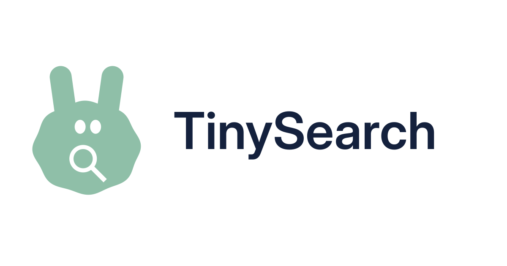

<!-- mcp-name: io.github.TinySuiteHQ/tinysearch -->

<div align="center">

# TinySearch

<a href="https://tinysuite.dev">
  
</a>

**Spend tokens on answers, not webpages.**

Part of [TinySuite](https://tinysuite.dev). Comes built in to [TinyWebUI](https://github.com/TinySuiteHQ/TinyWebUI), and works with any MCP client.

[](https://tinysuite.dev)
[](https://pypi.org/project/tinysuite-search/)
[](https://pepy.tech/projects/tinysuite-search)
[](https://github.com/TinySuiteHQ/TinySearch/actions/workflows/ci.yml)
[](LICENSE)
[](pyproject.toml)
[](https://github.com/TinySuiteHQ/TinySearch/releases)
[](https://github.com/TinySuiteHQ/TinySearch/commits/main)
[](https://hub.docker.com/r/marcellm01/tinysearch)
[](https://discord.gg/mFFKF9bf5e)


**[Read the documentation → tinysuite.dev/docs/tinysearch](https://tinysuite.dev/docs/tinysearch/)**

</div>

---

TinySearch is the web-research layer of [TinySuite](https://tinysuite.dev), a set of small, local-first tools that make agents spend tokens on useful work rather than overhead. It searches the web, reads the best pages, removes low-value content, and returns compact evidence with source URLs, so your model receives the useful passages instead of paying to process entire webpages.

It is retrieval, not summarization: every returned chunk is the original page text, unedited and still attached to its URL, so what you cite is what the page actually said. In a benchmark against a plain search-then-fetch agent reading the same pages, it sent 64% fewer tokens to the model ([docs/token-savings.md](docs/token-savings.md)).

## Highlights

- **No vendor in the loop.** No TinySearch account, no required API key, no per-request billing, no analytics service or hosted scraped-data cache. DDGS search and local ONNX embeddings are the defaults.
- **Source-grounded by construction.** A claim in your agent's answer traces back to one specific passage instead of stopping at "the vendor's model said this."
- **Selection happens before the model.** Local BM25 and embedding rerank pick pages and passages within an evidence budget you control.
- **Five small MCP tools.** `search`, `scrape_urls`, `browser_navigate`, `browser_act` and `get_current_datetime`, with batching so one call can cover independent subquestions.
- **A real browser when a page needs one.** The browser tools reuse the scraper's Chromium, act only on elements the model has seen, and can't execute code.
- **Private by default.** Nothing about what was searched is recorded unless you turn activity recording on, and OpenTelemetry export never carries queries, URLs or page text.
- **Bring your own stack when needed.** SearXNG, Brave, OpenAI-compatible embeddings, an external browser over CDP, proxies, and an optional fallback fetcher.
- **Works where agents already work.** MCP over stdio or Streamable HTTP, Python, FastAPI, or Docker.

## Quick start

| Tier | Use it when | Entry point | Search backend |
| --- | --- | --- | --- |
| 1. Python library | You are building with TinySuite or Python | `pip install tinysuite-search` | DDGS |
| 2. One-command MCP | An MCP client should launch TinySearch for you | `uvx --from "tinysuite-search[server]" tinysearch` | DDGS |
| 3. Docker + SearXNG | You want the full self-hosted stack and HTTP MCP | `docker compose ... up -d` | Bundled SearXNG |

Tiers 1 and 2 need no search service. Tier 3 adds a dedicated SearXNG service, persistent model storage, and a network MCP endpoint; the [installation guide](https://tinysuite.dev/docs/tinysearch/#docker-with-searxng) covers it.

With [`uv`](https://docs.astral.sh/uv/) installed, add TinySearch to any MCP client:

```json
{
  "mcpServers": {
    "tinysearch": {
      "command": "uvx",
      "args": ["--python", "3.12", "--from", "tinysuite-search[server]", "tinysearch"]
    }
  }
}
```

The client launches TinySearch over stdio when it needs it. No repository clone, hosted account, or paid search key is required.

Fast `search` starts without Chromium or an embedding model. The first scrape initializes Chromium, and focused scraping also initializes the configured embedding model. Pre-warm both ahead of time if you will use those workflows:

```bash
uvx --from "tinysuite-search[server]" tinysearch setup
```

<p align="center">
  
</p>

From Python, `pip install tinysuite-search` and call `search` and `scrape_urls` directly ([Python library](https://tinysuite.dev/docs/tinysearch/#python-library)). The recommended flow is the same everywhere: `search` for lightweight discovery, then `scrape_urls` for the pages worth reading.

## Documentation

The full reference lives at **[tinysuite.dev/docs/tinysearch](https://tinysuite.dev/docs/tinysearch/)**:

| Topic | Covers |
| --- | --- |
| [Quick start](https://tinysuite.dev/docs/tinysearch/#quick-start-mcp-over-stdio) | MCP over stdio |
| [Installation](https://tinysuite.dev/docs/tinysearch/#choose-an-installation) | Python, Docker with SearXNG, from source and entrypoints |
| [MCP tools](https://tinysuite.dev/docs/tinysearch/#mcp-tools) | Every tool, its parameters and response contract, including the browser tools |
| [What your agent gets](https://tinysuite.dev/docs/tinysearch/#what-your-agent-gets) | The recommended flow, retrieval rather than summarization, when not to use it |
| [Output formats](https://tinysuite.dev/docs/tinysearch/#output-formats) | What search and scrape results look like, the FastAPI endpoints |
| [Activity and management](https://tinysuite.dev/docs/tinysearch/#management) | Activity recording and the management views |
| [OpenTelemetry](https://tinysuite.dev/docs/tinysearch/#opentelemetry) | Traces and metrics |
| [Configuration](https://tinysuite.dev/docs/tinysearch/#configuration) | Every setting and environment variable: search backends, browser, CDP, proxies, the fallback fetcher |
| [Troubleshooting](https://tinysuite.dev/docs/tinysearch/#troubleshooting) | Installation checks and common failures |

In this repository: [docs/token-savings.md](docs/token-savings.md) is the benchmark and the script to rerun it, [docs/fallback-fetcher.md](docs/fallback-fetcher.md) is the full contract a fallback fetch service implements, and [configs/tinysearch_config.json](configs/tinysearch_config.json) is an annotated example configuration.

## Development

```bash
git clone https://github.com/TinySuiteHQ/TinySearch
cd TinySearch
python -m venv .venv
source .venv/bin/activate
pip install -e ".[server]"
python -m unittest discover tests
```

TinySearch supports Python 3.12 and newer. CI tests Python 3.12, 3.13, and 3.14 across Linux, macOS, and Windows.

Questions, ideas, and bug reports are welcome on [Discord](https://discord.gg/mFFKF9bf5e), in [GitHub issues](https://github.com/TinySuiteHQ/TinySearch/issues), or by [email](mailto:hello.marcbuilds@gmail.com).

## License

TinySearch reads public pages and returns selected excerpts to the calling client. Search, crawling, local embeddings, and reranking can run without sending page content to an embedding provider. If you choose an OpenAI-compatible embedding backend, that provider receives the text sent for vectorization.

TinySearch is available under the [MIT License](LICENSE). Downloaded model weights remain subject to their respective model-card licenses. See [NOTICE](NOTICE) for third-party distribution details.
