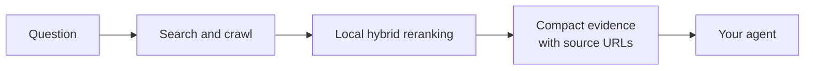

# How TinySearch works

TinySearch is a retrieval layer, not another agent, chat interface, hosted
search product, or permanent web index. It does not spend another model call
writing the final answer: it hands the calling agent selected evidence and
leaves the answer to it.

## The flow

1. `search` returns backend-ordered titles, URLs, previews, upstream dates, and
   backend outcomes without starting Chromium or an embedding model.
2. `scrape_urls` reads one to five known pages concurrently. Omit an item's
   query or use `"*"` to keep clean Markdown in page order within the
   configured token budget.
3. Supply a focused item query when TinySearch should chunk and hybrid-rank
   that page before returning evidence.
4. The `browser_*` tools step in only when `scrape_urls` can't reach the
   content because it needs interaction. See
   [browser-automation.md](browser-automation.md).



## The MCP tools

| Tool | Use it when |
| --- | --- |
| `search(items)` | You need fast, backend-ordered discovery without crawling or reranking; batch independent subquestions when useful |
| `scrape_urls(items)` | You know one to five pages; each item may use `*` for its configured clean page-order token budget |
| `browser_navigate` / `browser_act` | A page needs interaction before it can be read; see [browser-automation.md](browser-automation.md) |
| `get_current_datetime()` | A question depends on the current date or time |

See the complete [MCP tool reference](https://tinysuite.dev/docs/tinysearch/#mcp-tools)
for parameters and response contracts.

## What your agent gets

The recommended flow is `search` for lightweight discovery, then `scrape_urls`
for the pages worth reading.

Search returns structured JSON. Use one item for a simple lookup; add multiple
items only for independent subquestions or source strategies. `domains` is a
hard positive source restriction and accepts a domain plus its subdomains:

```json
{"items":[{"query":"Form 8-K Tesla","domains":["sec.gov"]}]}
```

Each search item reports its own results and compact backend attempts. A zero
result response is distinct from a blocked, unavailable, or invalid backend.
`scrape_urls` returns selected Markdown evidence and separate related-link
navigation candidates, each with independent configured token ceilings.

MCP still uses its standard JSON-RPC transport envelope, including
protocol-level errors and optional `structuredContent`. Python and FastAPI keep
their structured JSON contracts for applications that need to store, inspect,
or transform the evidence.

## Retrieval, not summarization

TinySearch selects the passages worth keeping with local BM25 and embedding
rerank; it doesn't run a model over the page to rewrite or condense it. Every
returned chunk is the original page text, unedited, so what you cite is what
the page actually said. That keeps the pipeline fast and free to run locally,
at the cost of not compacting as aggressively as a dedicated reduction model
could. A learned reduction step is a direction we may explore later; it isn't
part of TinySearch today.

How much this saves, and how it is measured, is in
[token-savings.md](token-savings.md).

## When not to use TinySearch

TinySearch is intentionally lightweight. Use a commercial search API,
persistent crawler, or full search index when you need:

- guaranteed search coverage or an SLA
- large-scale or scheduled indexing
- long-term page storage and change history
- enterprise observability and access controls
