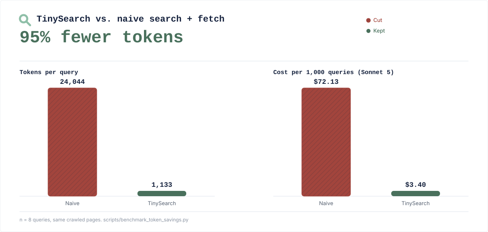

# Token savings

A search result is not yet useful evidence. Agents often have to open several
pages, ingest navigation and boilerplate, and spend paid input tokens deciding
which passages matter.

TinySearch moves that work in front of the model, which lowers cost in three
ways:

- **Smaller model context.** Only the best-ranked evidence chunks are returned,
  within a controlled evidence budget.
- **No metered search API required by default.** TinySearch can search through
  DDGS without a paid search provider.
- **Local retrieval by default.** ONNX embeddings and hybrid reranking run on
  your machine instead of creating embedding API charges.

Search broadly. Read locally. Pay the model only for the evidence that matters.

Actual savings depend on the pages, evidence limits, client model, and provider
pricing. TinySearch reduces the web content sent to the model; it does not
control what the client does with that evidence afterward.

## The benchmark

<p align="center">
  
</p>

The cost panel uses an illustrative $3.00 per million input-token rate and
excludes search, crawling, model output, and downstream agent use.

The naive baseline isn't a strawman product, it's the same pages TinySearch
crawled for each query, fed to the model unfiltered, the way a generic
"search, then fetch the page" tool (a plain web-search-plus-fetch loop, the
kind built into most coding agents) would. Measured against the current
recommended flow (`search` then `scrape_urls`) and counted on the actual MCP
tool-result text, TinySearch's primary interface. Reproduce or rerun it
yourself:

```bash
python scripts/benchmark_token_savings.py --json-out report.json
```
